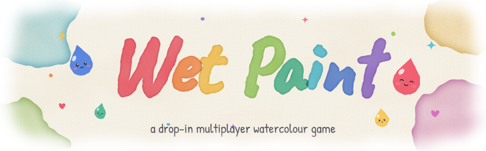

# wetpaint

> [!NOTE]
> This project was built to test Fable 5.2.

<p align="center">
  <picture>
    <source media="(prefers-color-scheme: dark)" srcset="docs/banner/banner-1-wash-dark.svg">
    
  </picture>
</p>

A multiplayer watercolour game. Each player is a drop of paint on a shared
sheet of paper. You dry out in about a minute, leave a trail while alive, and
a bloom with your name when you die.

- `server/` – Go server (simulation, WebSockets, bots)
- `client/` – TypeScript + Canvas 2D, built with Vite
- `protocol/` – wire spec ([PROTOCOL.md](protocol/PROTOCOL.md)) and shared paint test vectors

## Running

Needs Go 1.27+ and Bun 1.4+.

```sh
cd client && bun install && bun run build
cd ../server && go run ./cmd/server -static ../client/dist   # http://localhost:8080
```

With hot reload, run the server without `-static` plus the Vite dev server,
which proxies `/join` and `/ws` to `VITE_SERVER` (default `http://localhost:8080`):

```sh
cd server && go run ./cmd/server
cd client && bun run dev   # http://localhost:5173
```

Or with Docker Compose (server, Vite and Valkey):

```sh
docker compose up --build   # :5173 hot reload, :8080 built client
```

Drop `-valkey valkey:6379` from `docker-compose.yml` to use the in-memory store.

### Bots

```sh
cd server && go run ./cmd/bots -n 30 -url ws://localhost:8080/ws
```

`-url` defaults to `$WETPAINT_URL`, then `ws://localhost:8080/ws`. More than 60
bots spill onto further pages. Other flags: `-ramp`, `-report`, `-lazy` (never
seek water).

### Tests

```sh
cd server && go test -race ./...
cd client && bun run test && bun run typecheck
```

`go test ./internal/paint -update` regenerates `protocol/paint_vectors.json`.
The client tests replay that file to keep both paint implementations identical.

## Server

| Flag          | Default                | Meaning                                                                |
| ------------- | ---------------------- | ---------------------------------------------------------------------- |
| `-addr`       | `:$PORT`, else `:8080` | listen address                                                         |
| `-static`     | off                    | directory of the built client, served at `/`                           |
| `-valkey`     | off                    | Valkey `host:port`; if empty, an attached Deploio KVS, else in-memory  |
| `-public-url` | none                   | this instance's public WebSocket URL, for multi-instance routing       |
| `-origins`    | localhost, 127.0.0.1   | extra allowed WebSocket `Origin` hosts (same-origin is always allowed) |

| Endpoint           |                                                                                                     |
| ------------------ | --------------------------------------------------------------------------------------------------- |
| `GET /join`        | which page to join and its WebSocket URL                                                            |
| `GET /ws[?page=N]` | game socket                                                                                         |
| `GET /healthz`     | liveness                                                                                            |
| `GET /metrics`     | Prometheus (`wetpaint_players`, `wetpaint_tick_duration_seconds`, `wetpaint_grid_resyncs_total`, …) |

## Architecture

```
browser ── GET /join ──▶ hub ──▶ store (page directory)
        ── WebSocket ──▶ client reader ─┐ inputs
                                         ▼
                              page goroutine: World.Step @ 20 Hz
                                         │ frames
        ◀── client writer ◀── bounded queue (stale State dropped)
                                         │ jobs (dropped on overflow)
                                         ▼
                              persister ──▶ store (Valkey or memory)
```

Server packages (`server/internal`):

- `game` – pure simulation, no clocks or I/O. `constants.go` holds all tuning.
- `paint` – integer paint grid, snapshots, zlib.
- `protocol` – message codec.
- `server` – hub, one goroutine per page owning its `World` (no locks), reader
  and writer per connection, metrics, persister.
- `store` – `Memory` and `Valkey`: page directory, leaderboards, grid snapshots
  every 30 s.
- `names` – name sanitising.

The tick loop never touches the store. Slow clients lose droppable messages
(State, Leaderboard, Pong); a client that falls behind on paint ops is
disconnected, since it would desync.

Client modules (`client/src`): `net` and `protocol` (transport, codec),
`paintGrid` (same paint algorithm as the server), `prediction`/`interpolation`/`movement`
(own drop predicted with input replay, others drawn ~100 ms behind), `render/`
(tile-based watercolour shading, doodles, mini-map, postcard), `ui/` and `audio`.

## Protocol

See [protocol/PROTOCOL.md](protocol/PROTOCOL.md). In short:

- The grid is sent once as a zlib snapshot in `Welcome`, then only paint ops
  (stamps, erases). Both sides apply them with the same integer maths, so the
  algorithm is part of the protocol: change spec, both implementations and the
  vectors together.
- Every 5 s a `GridCheck` checksum is sent; a mismatching client requests a
  fresh grid. Rising `wetpaint_grid_resyncs_total` means the implementations
  disagree.
- A page holds 60 players and 20 spectators. Close code 4001 = page full,
  4002 = idle/never joined.
- `Welcome` carries gameplay constants and the palette.
- Before `Join`, a connection is a spectator and sees the whole page.

## Tuning

- Gameplay: `server/internal/game/constants.go`. Clients get the values via
  `Welcome` after a server restart.
- Visuals only: `client/src/constants.ts` (interpolation, camera, and the
  `PAINT` block for the watercolour look).

## Deploying

### Deploio

The `Dockerfile` image contains the server (serving the client) and the
`wetpaint-bots` binary.

```sh
nctl create project org-wetpaint --wait
nctl auth set-project org-wetpaint
nctl create kvs wetpaint --memory-size 256Mi --wait
nctl create app wetpaint \
  --git-url https://github.com/thde/wetpaint.git \
  --build-type dockerfile \
  --replicas 1 \
  --size standard-1 \
  --health-probe-path /healthz \
  --service cache=keyvaluestore/wetpaint \
  --wait

nctl get app wetpaint  # shows the *.deploio.app host
```

Bots run as a worker job. Deploio doesn't inject the app URL, so set it:

```sh
nctl update app wetpaint \
  --env WETPAINT_URL=wss://<host>/ws \
  --worker-job-name bots \
  --worker-job-command "/usr/local/bin/wetpaint-bots -n 10" \
  --worker-job-size mini
```

Remove with `nctl update app wetpaint --delete-worker-job bots`.

Notes:

- Keep `--replicas 1`. `/join` and `/ws` are load-balanced separately, so a
  second replica splits players across half-empty pages.
- CPU is the limit; memory stays under 100 MB. A full page needs ~0.3–0.4 CPU,
  so `standard-1` fits about one page. Scale the size up, not out. Bots at
  `-n 30` need ~0.15–0.2 CPU. A p99 `wetpaint_tick_duration_seconds` near 50 ms
  means the app is too small.
- Without `-valkey`, the server uses the attached KVS via the injected
  `NINE_KVS_<NAME>_*` variables (TLS). It refuses to start if more than one is
  attached.

### Elsewhere

```sh
docker build -t wetpaint .
wetpaint -addr :8080 -static /static -origins play.example.com
```

Put it behind a proxy that supports WebSocket upgrades and long idle
connections. Without `-valkey host:6379`, the painting and leaderboards are
lost on restart.

For several instances, share one Valkey and give each its own directly
reachable `-public-url`. `/join` on any instance returns a page with room,
wherever it lives, so `/join` and static files can sit behind a normal load
balancer. Directory entries expire 10 s after an instance stops heartbeating;
a reclaimed page restores from its last snapshot (kept for an hour). This
routing is only unit-tested, never run with two live instances.
